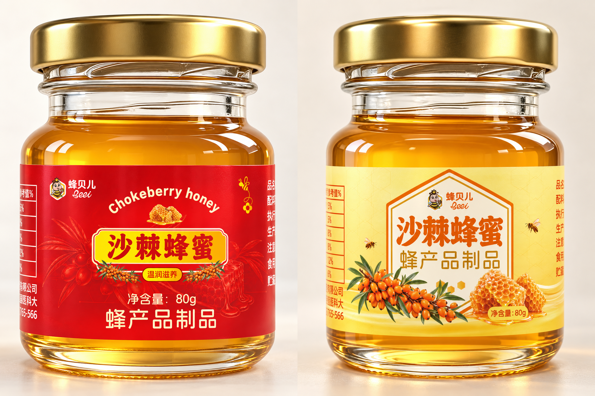

# 两款蜂蜜瓶效果图 · 去竖接缝 · 瓶贴瓶身分层 PSD

已去除两瓶颈部至肩部的竖向接缝/亮线；保留原瓶贴文字、图案及其余可见画面。

- **[下载分层 PSD](honey_jar_two_variants_layered_no_seam.psd?raw=true)**
- [下载备用 ZIP（PSD + 预览 + 说明）](honey_jar_two_variants_layered_complete.zip?raw=true)
- [查看合并预览](honey_jar_two_variants_layered_no_seam.png)
- [使用说明](使用说明.txt)

2172 × 1448 像素，RGB / 8 位，300 dpi。默认左右并排，单款保留原1086 × 1448像素。

## 图层

两个真实分组：红款、黄款。每组各有独立的瓶贴、完整瓶身（金盖/玻璃/蜂蜜）和背景投影，共六个内容图层。
可分别移动、变换或隐藏。隐藏瓶贴后显示完整补绘裸瓶，不会留下空洞或原印刷图案。
这是像素分层PSD；瓶贴中文字为效果图像素，不是可直接重新输入的文字层，也不是三维建模工程。

## 检查

修补范围之外的原图像素不变，两款原瓶贴文字及图案未重绘。两款默认强制重合成与修补后的PNG逐像素一致。
原生PSD分组、透明图层和隐藏瓶贴后的完整裸瓶已通过ag-psd和psd-tools回读验证；未在Adobe Photoshop桌面界面实际打开测试。

