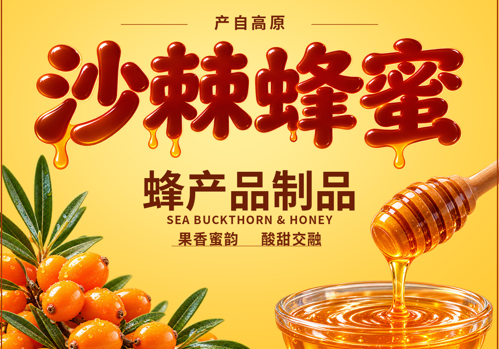

# 沙棘蜂蜜 · 第三版中央主展示面

- [下载分层 PSD（约 6.4 MB）](https://github.com/2857832609g-bot/daimacangku-/raw/refs/heads/codex/honey-label-v3-download-20261029/artwork/honey-label-v3/seabuckthorn-honey-v3-layered.psd)
- [下载完整素材包（约 23.5 MB，含 PSD、字体、透明素材和说明）](https://github.com/2857832609g-bot/daimacangku-/raw/refs/heads/codex/honey-label-v3-download-20261029/artwork/honey-label-v3/seabuckthorn-honey-v3-PSD-package.zip)

如果直接下载被浏览器拦截，请在本目录打开对应文件，再点击 GitHub 的 **Download raw file** 按钮。

尺寸约 5 × 3.5 cm，1181 × 827 像素，600 ppi，RGB / sRGB。

沙棘和蜂蜜各自独立为透明图层。辅助文字均为独立的原生可编辑文字层。蜜滴主标题保留为独立艺术字像素层，并另附隐藏的可编辑标题替换层。完整素材包内包含所用开源字体及许可说明。

这是基于第三版合成图重建的分层文件。已用独立 PSD 解析器检查 12 个图层、分辨率、中文文字、透明通道和合成预览；未使用 Adobe Photoshop 桌面软件实机验证。

此分支用于文件交付。文件的可见性由仓库设置决定。
