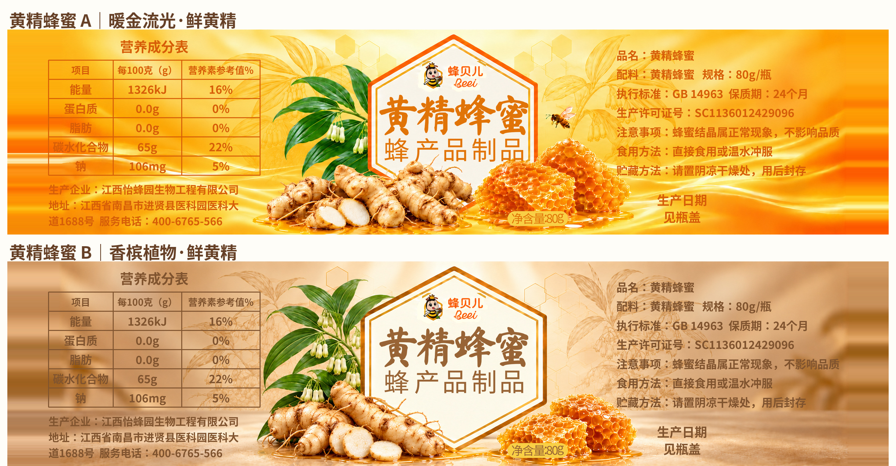

# 黄精蜂蜜：新植物参考修订两稿

A 暖金流光 / B 香槟植物。两稿均改为自然米黄分枝黄精、平行脉宽披针叶与下垂绿白钟形花序，背景植物线稿同步替换；左黄精、右蜂巢组合更饱满。

画布4500×1050px，15×3.5cm，80g，固定文字与Logo沿用原系列。六边形仅等比适配，原十张未覆盖。

- [A 原图](labels/huangjing_revised_A_15x3_5cm.png)
- [B 原图](labels/huangjing_revised_B_15x3_5cm.png)
- [A/B 对照](previews/huangjing_revised_AB_preview.jpg)
- [完整下载包](huangjing_botanical_revision_two_15x3_5cm.zip)

