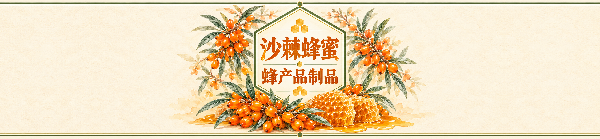

# 沙棘蜂蜜标签 · 15 × 3.5 cm

奶油手绘风、绿色六边形边框、沙棘橙文字；主体居中，左右留白供补充产品信息。

- [下载 PSD](sea_buckthorn_honey_15x3_5cm.psd?raw=true)
- [下载 ZIP（含 PSD、PNG）](honey_label_15x3_5cm.zip?raw=true)
- [查看 PNG 预览](sea_buckthorn_honey_15x3_5cm.png)

3150 × 735 像素，533.4 dpi，对应 15 × 3.5 cm，RGB / 8 位。
PSD 含主画面与留白背景两个像素图层；现有标题属于图像内容，并非可直接改字的文字图层。

请先下载到本机，再用 Photoshop 打开 PSD。ZIP 需解压后打开其中的 PSD。

