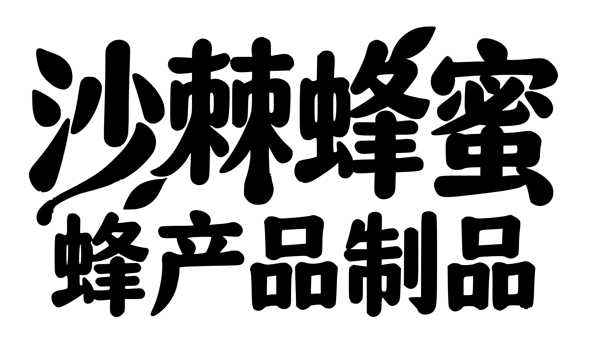

# 沙棘蜂蜜 · 蜂产品制品｜白底黑字矢量字稿

按参考图片中的原字形单色化描摹，保留两行排版、叶片及蜜滴轮廓，未用其他字体替换。

- **[下载完整版 ZIP（SVG / PDF / EPS / 单行 SVG / 高清预览）](honey_lettering_black_vector_complete.zip?raw=true)**
- [下载 SVG](honey_lettering_black_vector.svg?raw=true)
- [下载矢量 PDF](honey_lettering_black_vector.pdf?raw=true)
- [下载矢量 EPS](honey_lettering_black_vector.eps?raw=true)
- [单独主标题 SVG](honey_title_black_vector.svg?raw=true)
- [单独副标题 SVG](honey_subtitle_black_vector.svg?raw=true)
- [使用说明](使用说明.txt)

SVG 使用真正闭合贝塞尔路径，白底黑字，两行分别分组，不嵌入图片、无字体依赖；PDF 检查无图片、无字体资源，仅含矢量图形。
可在 Illustrator、CorelDRAW、Inkscape 等软件中编辑路径和颜色，放大不损失矢量清晰度。已转曲，不能像字体文字层一样直接重新输入文字。
根据像素图进行描摹平滑，不是原始字体文件。PNG 仅用于预览。

